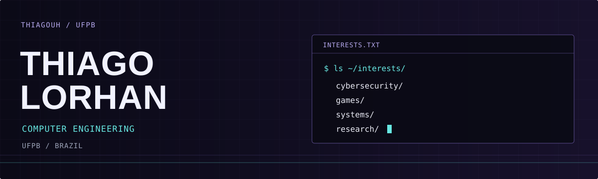
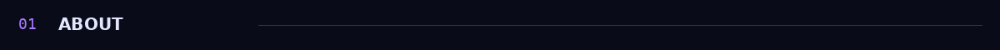
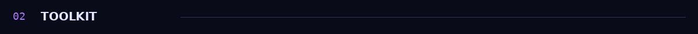
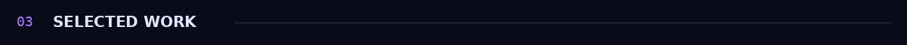
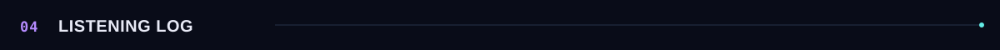
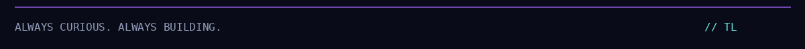

  
  

  
  

I'm **Thiago Lorhan**, a Computer Engineering student at **UFPB**, Brazil.

I enjoy exploring different areas of computing, understanding how things work, and turning ideas into practical projects. My current research work is part of an Embrapii-supported project.

### `research & community`

<table width="100%">
  <tr>
    <td align="center" width="50%">
       
      <strong>TAIL</strong> 
      Member of the Technology and Artificial Intelligence League at UFPB
    </td>
    <td align="center" width="50%">
       
      <strong>EMBRAPII</strong> 
      Researcher in an Embrapii-supported project at UFPB
    </td>
  </tr>
</table>

  
  
  
  

  
  
  
  
  

| Project | Explore |
| :--- | :--- |
| **Machine learning datasets** | [Dataset exercises and notebooks →](https://github.com/Thiagouh/ml-datasets-solved) |
| **Teaching & learning ML** | [My machine learning learning space →](https://github.com/Thiagouh/teaching-and-learning-machine-learning) |
| **Space Invaders-style game** | [A game project →](https://github.com/Thiagouh/Jogo-estilo-Space-Invaders) |

### `activity.log`

  

  

 

